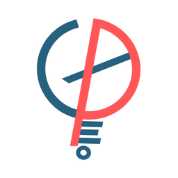

<p align="center"></p>

# AICDE Design Library

一套做網站和 App 用的現成元件，像按鈕、輸入框、表格、對話框。拿來直接用，就不用每個專案從頭畫一次。

- **看網站**：https://zhijian090195.github.io/library/
- **看 Flutter 版**：https://zhijian090195.github.io/library/flutter-demo/

## 這是什麼

- **59 個元件**：按鈕、表單、日期、表格、對話框、通知、選單……做網站常用的都有。
- **15 種風格**：同一個按鈕，可以一鍵換成紙雕、可愛、醫療、金融等風格。不只換顏色，連質感都會變。
- **深色模式**：每種風格都有。
- **三種寫法都能用**：一般網頁、React、Flutter（手機 App），三個版本長得一樣。
- **好操作**：只用鍵盤也能操作，視障者用的讀屏軟體也念得出來。

## 15 種風格

| 風格 | 長什麼樣 | 適合 |
|---|---|---|
| 紙雕（預設） | 像一層層紙疊起來，按下去會凹 | 品牌官網、一般產品 |
| 簡潔 `clean` | 乾淨、細框、沒有陰影 | 後台、工具 |
| 暖紙雕 `paper` | 米色紙張、暖色系 | 生活風格、餐飲、文創 |
| 混合媒材 `ink` | 手繪墨線、不規則邊角 | 創意工作室、教育 |
| 柔光 `soft` | 圓圓的按鈕、柔和陰影 | 消費型 App、健康 |
| 網點絲印 `riso` | 印刷網點、套色錯位 | 活動、獨立出版 |
| 新粗野 `brutal` | 粗黑框、直角、打字機字體 | 開發者工具、新創 |
| 手縫布藝 `stitch` | 車縫虛線 | 手作、親子、寵物 |
| 水彩票根 `ticket` | 票券打孔、水彩暈染 | 旅遊、展覽、售票 |
| 積木 `block` | 厚厚的底座、立體感 | 遊戲、兒童教育 |
| 藍圖 `blueprint` | 工程圖細線 | 工程、建築、硬體 |
| 醫療 `clinical` | 海藍色、按鈕大好點 | 醫院、保險、政府 |
| 可愛 `cute` | 大圓角、貼紙感、會彈跳 | 寵物、兒童、社群 |
| 金融 `finance` | 資訊密集、數字對齊 | 交易平台、報表 |
| 編輯 `editorial` | 報紙雜誌感、襯線標題 | 媒體、部落格 |

到網站的「主題」頁，可以看到每種風格套在整個頁面上的樣子。

## 怎麼用

依照你的專案類型，選一種：

### 一般網頁

在 HTML 裡加兩行，就能用了。想換風格，在 `<html>` 加上風格名稱：

```html
<html data-theme-style="cute">   <!-- 換成「可愛」風格；不寫就是預設的紙雕 -->
<head>
  <link rel="stylesheet" href="https://zhijian090195.github.io/library/assets/aicde-ui.css">
  <script src="https://zhijian090195.github.io/library/assets/aicde-ui.js" defer></script>
</head>
<body>
  <button class="a-btn a-btn--primary">儲存</button>
</body>
</html>
```

每個元件怎麼寫，網站上都有範例可以直接複製。

### React

先安裝：

```bash
npm install aicde-ui
```

再這樣用：

```tsx
import 'aicde-ui/style.css';
import { ThemeProvider, Button } from 'aicde-ui';

<ThemeProvider theme="cute">
  <Button variant="primary">儲存</Button>
</ThemeProvider>
```

更多說明：[`react/README.md`](react/README.md)

### Flutter（手機 App）

在 `pubspec.yaml` 加上：

```yaml
dependencies:
  aicde_ui:
    git:
      url: https://github.com/zhijian090195/library.git
      path: flutter
```

再這樣用：

```dart
MaterialApp(
  theme: aicdeThemeData(style: AicdeThemeStyle.cute),
  darkTheme: aicdeThemeData(style: AicdeThemeStyle.cute, brightness: Brightness.dark),
);

AicdeButton(label: '儲存', variant: AicdeButtonVariant.primary, onPressed: save);
```

更多說明：[`flutter/README.md`](flutter/README.md)

## 給開發者

<details>
<summary>資料夾說明、怎麼改顏色、怎麼跑測試（點開）</summary>

### 資料夾

```
index.html     網站首頁
assets/        網頁版元件（aicde-ui.css、aicde-ui.js）和網站內容
react/         React 版
flutter/       Flutter 版
tokens/        顏色、圓角這些設定，三個版本共用
tests/         自動測試
```

### 想改顏色或圓角

顏色、圓角、按鈕高度都寫在 [`tokens/tokens.json`](tokens/tokens.json) 這一個檔案。改完執行下面這行，網頁版和 Flutter 版會一起更新：

```bash
node tokens/build.mjs
```

詳細說明：[`tokens/README.md`](tokens/README.md)

### 在自己電腦上跑

```bash
# 開網站（打開 http://localhost:8000）
python3 -m http.server 8000

# 跑測試
python3 tests/web/test_core.py            # 網頁版
cd react && npm install && npm test       # React
cd flutter && flutter test                # Flutter

# 開 Flutter 範例
cd flutter/example && flutter run -d chrome
```

### 更新網站上的 Flutter 範例

```bash
cd flutter/example
flutter build web --release --base-href /library/flutter-demo/ -o ../../flutter-demo
rm -rf ../../flutter-demo/canvaskit
```

推上 GitHub 後，網站會自動更新。

</details>

## 授權

- **程式碼**：MIT 授權，可以免費使用、修改、商用。
- **AICDE 名稱和 logo**：不包含在內。用這套元件做自己的產品時，請換成你自己的名稱和 logo。
- **字型**：範例裡用的都是免費開源字型，授權條文在 [`flutter/example/fonts/OFL.txt`](flutter/example/fonts/OFL.txt)。

小提醒：預設風格的珊瑚紅按鈕配白字，顏色對比比無障礙標準低一點。這是為了保留品牌色刻意的選擇；如果你的產品很重視無障礙（例如政府、醫療），建議改用「醫療」風格。
